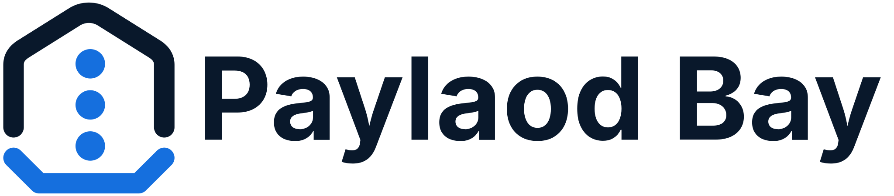
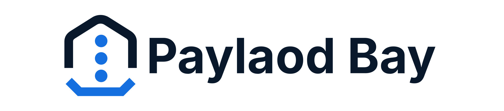
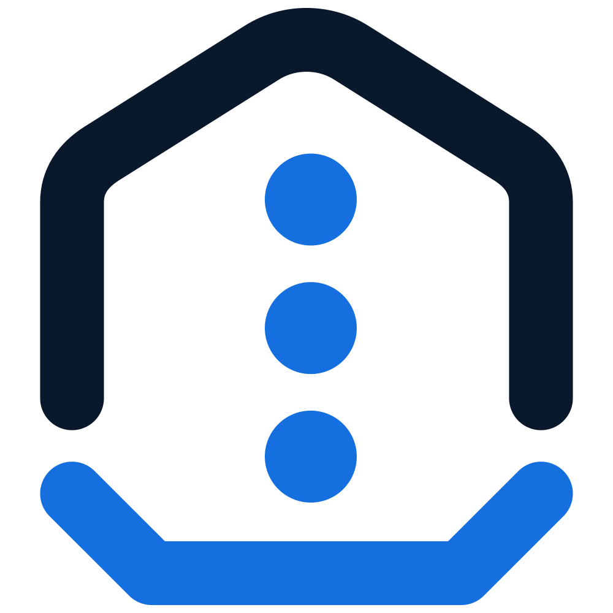
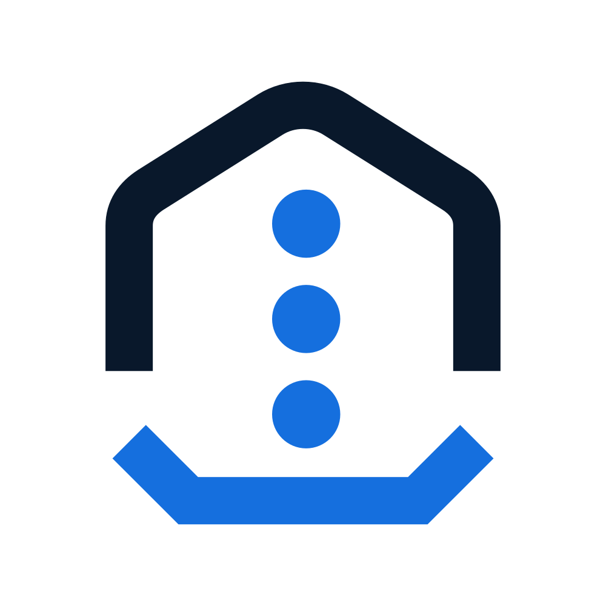
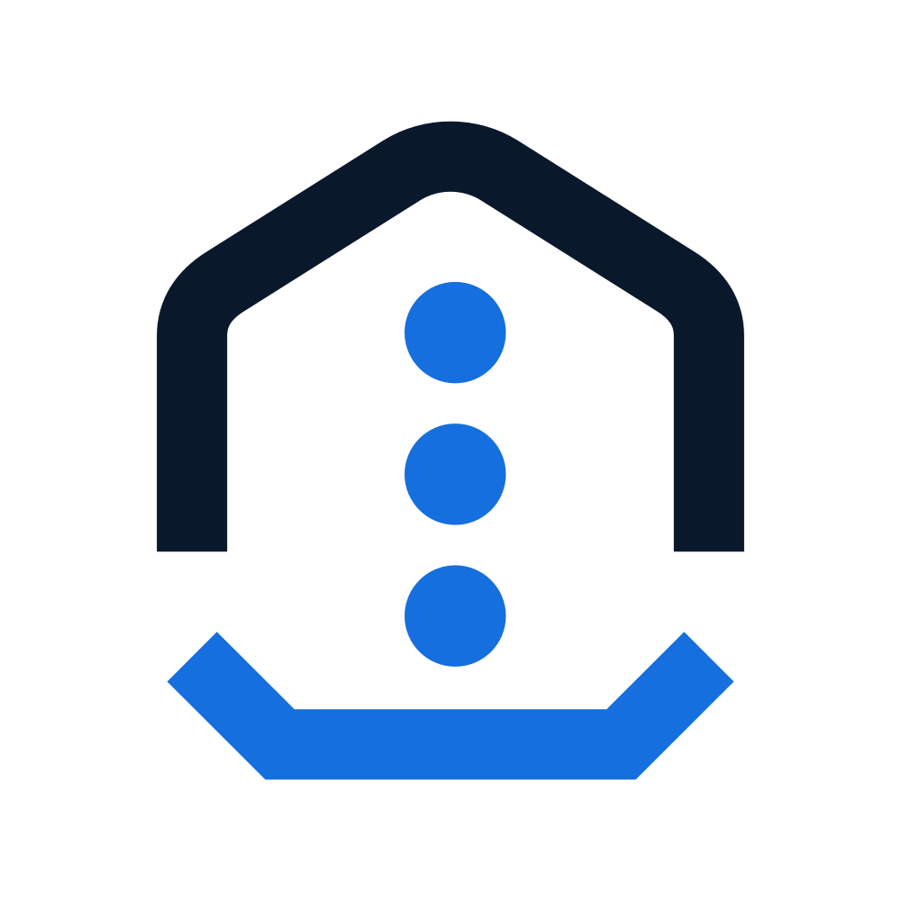
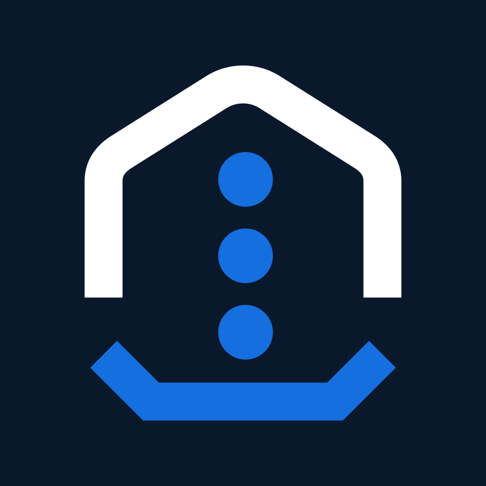
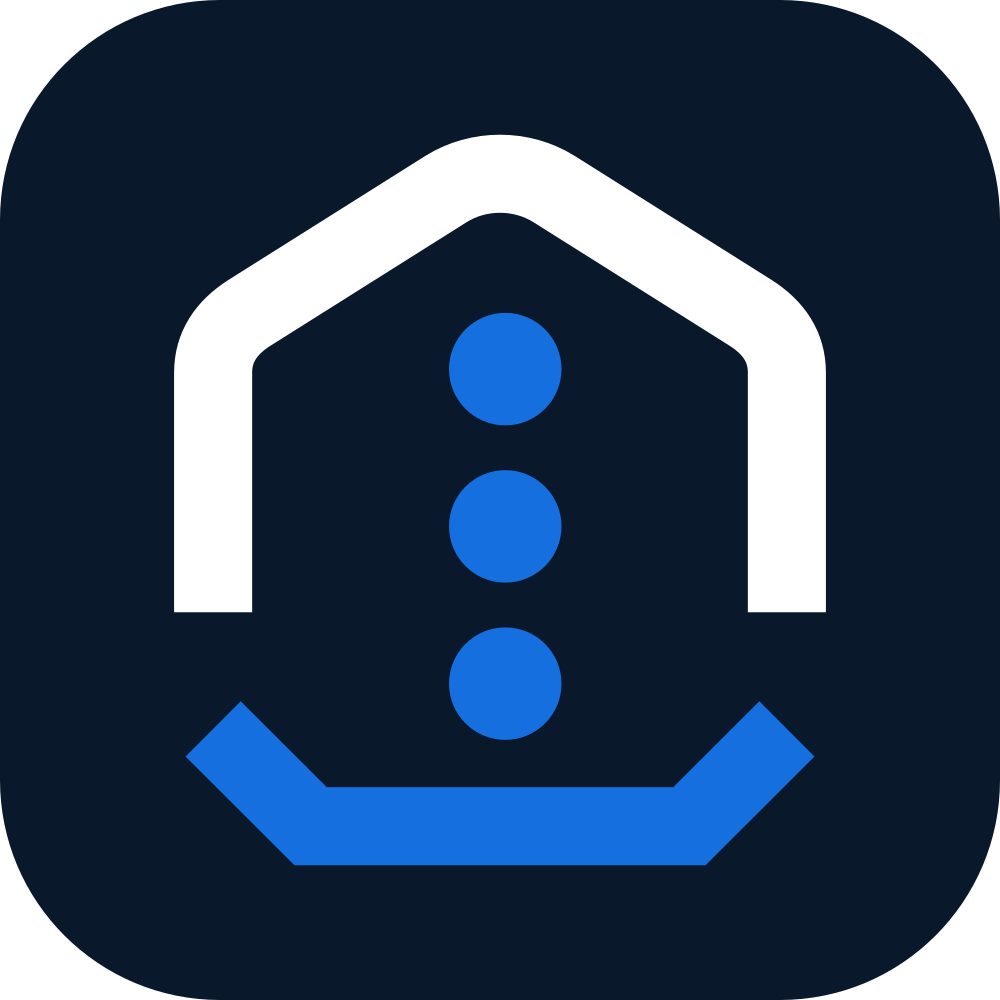
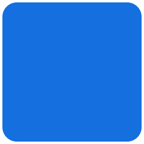
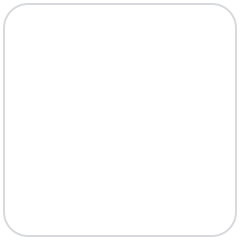

# Payload Bay Brand Guide

Payload Bay is an open-source, self-hosted webhook gateway for receiving,
verifying, storing, routing, retrying, and replaying events.

This is the canonical reference for the Payload Bay identity. It explains the
name, claims, visual concept, assets, usage rules, colors, typography, voice,
and terminology. It complements [`PRODUCT.md`](PRODUCT.md) and
[`DESIGN.md`](DESIGN.md), which are Theme Builder references, and it does not
replace the canonical SVG sources in [`src/assets`](src/assets).

## Product name and claims

Use the product name as **Payload Bay**. Do not abbreviate it as "PayloadBay",
"Payloadbay", or "PB" in public-facing copy unless an established technical
constraint requires an identifier.

`Payload` describes the contents of an incoming webhook or event. `Bay`
describes a safe landing place where events can be received, verified, stored,
inspected, routed, delivered, and redelivered.

Approved claims:

> A safe landing place for every event.

> Receive instantly. Deliver reliably.

> Reliable webhook delivery without coupling providers to your application.

The first claim is the primary claim. The second supports it. The third is an
alternative technical description for developer-facing contexts.

## Asset overview

The complete logo combines the mark and wordmark. The mark is the standalone
symbol. All variants below are generated from the canonical sources. Do not
create a second editable source from a generated file.

### Complete logo

#### Transparent variants

| Original | Transparent padded |
| --- | --- |
|  |  |

#### Light-surface variants

| Light panel | Light rounded |
| --- | --- |
|  |  |

#### Dark-surface variants

| Dark panel | Dark rounded |
| --- | --- |
|  |  |

### Mark and application icon

#### Transparent variants

| Original mark | Transparent padded |
| --- | --- |
|  |  |

#### Light-surface variants

| Light square | Light rounded |
| --- | --- |
|  |  |

#### Dark-surface variants

| Dark square | Dark rounded |
| --- | --- |
|  |  |

### Favicon

| Preview | Files | Source variant |
| --- | --- | --- |
|  | [`favicon.svg`](dist/favicon/favicon.svg), [16px PNG](dist/favicon/favicon-16x16.png), [32px PNG](dist/favicon/favicon-32x32.png), [48px PNG](dist/favicon/favicon-48x48.png), and [`favicon.ico`](dist/favicon/favicon.ico) | Light rounded mark |

## Logo concept

The Payload Bay mark translates the product name into a simple technical
metaphor.

The rounded upper form represents a protected receiving space. It may evoke a
roof, a dock, or a harbor entrance, but it is intentionally abstract. Events
do not arrive unprotected directly at an application. They first enter a
controlled environment.

The three blue dots represent incoming payloads or events. Their downward
progression shows the path from ingress to safe receipt. They are deliberately
neutral and may represent webhooks, messages, or other event types.

The blue lower form is the bay: the landing point where events are received,
verified, and stored before being routed onward. Its color subtly suggests
water without turning the identity into a literal harbor or shipping logo.

Together, the mark communicates:

> Events arrive, land in a protected bay, and continue through a controlled delivery path.

The mark is not intended to represent a house, security shield, or cloud. It
represents a protected technical receiving space. The nautical reference
remains abstract so Payload Bay continues to feel like infrastructure built for
developers.

## Logo and mark usage

Use the complete logo for first references, repository profiles, documentation
headers, websites, presentations, and other surfaces with sufficient horizontal
space.

Use the mark for application icons, favicons, compact navigation, social
avatars, and other constrained square surfaces.

| Need | Use |
| --- | --- |
| First or prominent brand reference | Complete logo |
| Narrow or square surface | Mark |
| Light or unpredictable background | Light panel or light rounded variant |
| Dark background | Dark transparent padded, dark panel or dark rounded variant |
| Surface with controlled contrast | Transparent original or transparent padded variant |

The editable source files are
[`src/assets/payloadbay-logo.svg`](src/assets/payloadbay-logo.svg) and
[`src/assets/payloadbay-mark.svg`](src/assets/payloadbay-mark.svg). Use the
ready-to-embed assets in [`dist/logo`](dist/logo), [`dist/mark`](dist/mark),
and [`dist/icon`](dist/icon).

### Clear space and minimum size

Keep clear space around a logo or mark equal to at least the diameter of one
blue payload dot. Do not place text, controls, borders, or other marks within
that space.

For digital use, keep the complete logo at least 160 pixels wide. Use the mark
instead when the complete logo would need to be smaller. Keep the mark at least
24 by 24 pixels where it must remain recognizable. The provided favicon files
are the deliberate exception for browser chrome.

Do not redraw the wordmark with a font. It is part of the canonical logo SVG.
Do not stretch, rotate, crop, outline, add effects to, or independently recolor
the logo or mark.

## Surface variants

The original logo and mark preserve their transparent source canvas. Generated
surface variants provide predictable contrast and padding without a second
maintained source file.

- Use `light-panel` or `light-rounded` when the artwork needs a white contrast surface.
- Use `dark-transparent-padded` for dark application surfaces that should remain visible through the asset; it uses the existing white-and-blue inverse artwork without a background.
- Use `dark-panel` or `dark-rounded` when a dark backing surface is needed.
- Use `transparent-padded` when the surrounding surface already provides contrast and the asset needs breathing room.
- Use rounded variants for friendly, contained surfaces such as profiles and documentation headers.
- Use panel variants when the surrounding layout is already rectangular or its corner treatment is unknown.

Dark variants change the navy artwork to white and retain the blue accent. Do
not create a custom inverse, monochrome, accent-background, or recolored
variant without updating the canonical brand assets and this guide.

## Colors

The visual identity uses a restrained blue and navy palette. The large swatches
below are generated from [`src/assets/brand-palette.json`](src/assets/brand-palette.json).

<table>
  <tr>
    <td align="center"></td>
    <td align="center"></td>
    <td align="center"></td>
  </tr>
  <tr>
    <td><code>#09182B</code></td>
    <td><code>#156FDE</code></td>
    <td><code>#FFFFFF</code></td>
  </tr>
  <tr>
    <td><strong>Logo navy.</strong> Primary logo artwork on light and transparent surfaces.</td>
    <td><strong>Accent blue.</strong> Payload dots, bay outline, and focused emphasis.</td>
    <td><strong>White.</strong> Inverse artwork and light surface variants. Its swatch has a subtle border so it remains visible on light surfaces.</td>
  </tr>
</table>

For product-interface colors, semantic states, and resolved light and dark
tokens, use [`DESIGN.md`](DESIGN.md). Do not treat this short identity palette
as a replacement for the interface token system.

## Typography

Use Inter for supporting brand and product copy. The complete logo's wordmark
is vector artwork, not typeset text, and must not be recreated with Inter or
another font.

Use clear hierarchy, short headings, and readable body copy. Refer to
[`DESIGN.md`](DESIGN.md) for the product type scale and letter-spacing tokens.

## Brand voice and terminology

Payload Bay communicates with technical precision, calmness, transparency, and
realism. Prefer specific statements over generic promises.

Use accurate language such as:

- At-least-once delivery
- Durable event storage
- Configurable retries
- Provider-aware verification
- Self-hosted by default

Avoid unsupported claims such as:

- Never lose an event
- Exactly-once delivery
- Infinite scalability
- Zero configuration
- Enterprise-grade at any scale

Keep nautical language within the identity and marketing metaphor. Use clear
technical resource names in product copy and documentation: Installation,
Workspace, Environment, Source, Route, Target, Runner, Event, Receipt,
Delivery, Attempt, and Incident.

## Usage rules

### ✅ Do

- use the existing generated variant that matches the surface;
- preserve proportions, colors, and clear space;
- use the complete logo when horizontal space allows; and
- use clear technical terms for product resources.

### ❌ Don't

- modify the logo or mark geometry;
- use a generated asset as a new editable source;
- add shadows, gradients, textures, borders, or decorative effects to the mark;
- place navy artwork on an insufficiently light background or white artwork on an insufficiently dark background;
- combine the mark with a newly typed "Payload Bay" wordmark;
- use the identity to imply a house, security shield, cloud product, or literal shipping service; or
- use nautical terms such as Dock, Ship, Harbor, Vessel, Captain, or Cargo Route as product resource names.

When in doubt, use an existing generated surface variant and preserve its
proportions, colors, and clear space.
